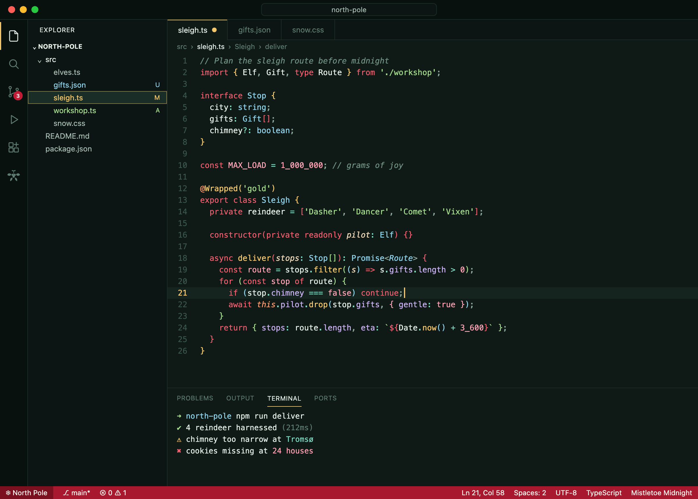
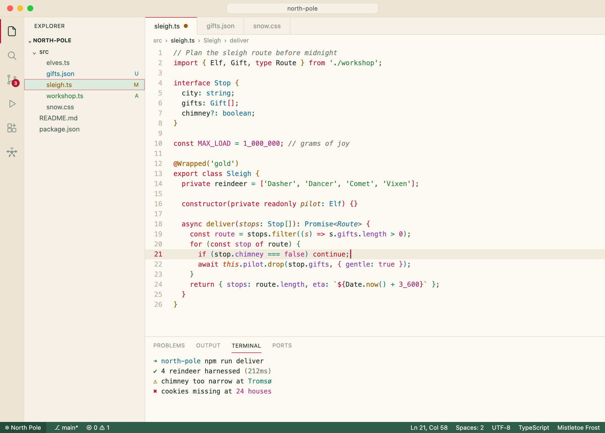
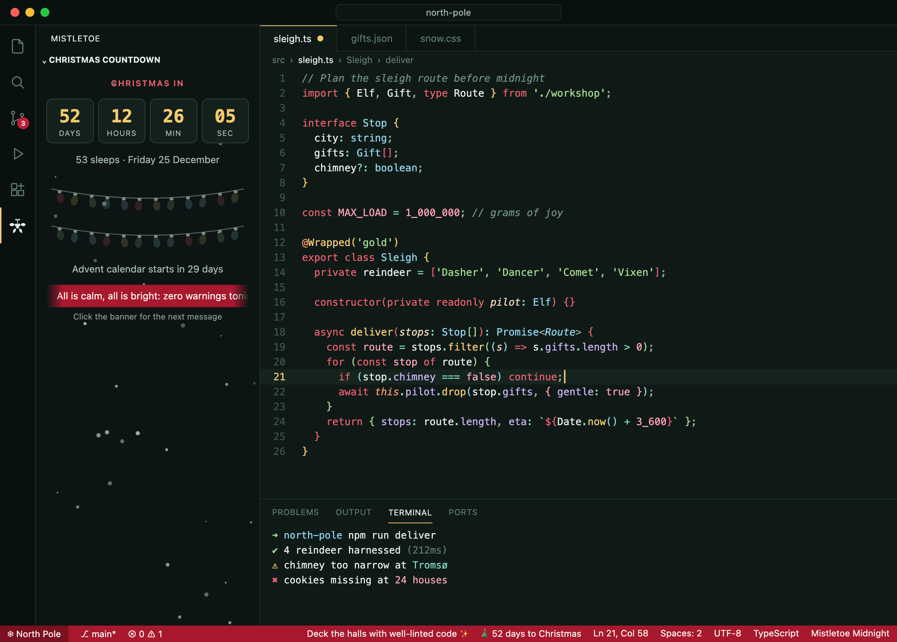

<p align="center"></p>

<h1 align="center">Mistletoe Theme</h1>

<p align="center">A cozy Christmas color theme for VS Code. Evergreen nights, holly-berry keywords, gold-star functions, brackets that light up like fairy lights, and a live countdown to Christmas with falling snow.</p>

## Mistletoe Midnight



## Mistletoe Frost



## Festive extras



- **Countdown to Christmas** in the status bar (`🎄 52 days to Christmas`), switching to hours and minutes on the final day.
- **Rotating festive messages** that type themselves out in the status bar. Click one to skip to the next.
- **Christmas Countdown view** (the mistletoe icon in the activity bar): a live clock, falling snow, a scrolling message banner, and 24 advent lights that switch on one per day through December.
- **Christmas Eve mode** for countries that celebrate on the 24th.
- Everything respects VS Code's **Reduce Motion** setting and can be switched off (see Settings).

## Theme features

- **Two variants**: *Midnight* (dark, deep evergreen) and *Frost* (light, warm fresh-snow paper).
- **Christmas-light brackets**: nested bracket pairs cycle through gold, red, green, ice blue, candy pink and sugar plum.
- **Readable first**: every syntax color meets WCAG AA contrast (4.5:1) against its background.
- **Full coverage**: semantic highlighting, terminal ANSI colors, git decorations, diff/merge, markdown and CSS.

## Install

1. Open the Extensions view (`Ctrl+Shift+X` / `Cmd+Shift+X`).
2. Search for **Mistletoe Theme** and click **Install**.
3. Run **Preferences: Color Theme** (`Ctrl+K Ctrl+T` / `Cmd+K Cmd+T`) and pick **Mistletoe Midnight** or **Mistletoe Frost**.

Bracket pair colors use VS Code's built-in `editor.bracketPairColorization.enabled`, which is on by default.

## Settings

| Setting | Default | What it does |
| --- | --- | --- |
| `mistletoe.countdown.enabled` | `true` | Countdown in the status bar |
| `mistletoe.countdown.target` | `christmasDay` | `christmasDay` (25 Dec) or `christmasEve` (24 Dec) |
| `mistletoe.ticker.enabled` | `true` | Rotating messages in the status bar |
| `mistletoe.ticker.style` | `typewriter` | `typewriter` or `static` |
| `mistletoe.ticker.intervalSeconds` | `15` | Seconds between messages |
| `mistletoe.messages` | `[]` | Your own messages; `{days}` and `{target}` are filled in |
| `mistletoe.snow.enabled` | `true` | Snow in the countdown view |

Commands (in the Command Palette): **Mistletoe: Show Christmas Countdown**, **Mistletoe: Next Festive Message**, **Mistletoe: Toggle Status Bar Countdown and Messages**.

The theme and the extras are independent: you can use the extras with any color theme, or turn them off and keep just the colors.

## Palette

| Ornament | Used for | Midnight | Frost |
| --- | --- | --- | --- |
| Holly berry | keywords, tags | `#f2606f` | `#b5172f` |
| Mistletoe leaf | strings | `#a3d98c` | `#2e7d3a` |
| Tree-top star | functions, attributes | `#f4c86a` | `#946200` |
| Icicle | types, classes | `#8fd3ea` | `#16708f` |
| Candy cane | numbers, constants | `#ffa3b5` | `#a8327f` |
| Sugar plum | properties | `#cdb4f5` | `#7a3fb0` |
| Eggnog / gingerbread | parameters | `#f1dcbc` | `#8b5a2b` |
| Fireside | `this`, decorators, regex | `#ff9a6b` | `#c2410c` |
| Peppermint | operators | `#7fdcc4` | `#0f7f6a` |
| Fresh snow / evergreen ink | text | `#e6eee8` | `#1e2d28` |

## Development

```bash
npm install
npm run build     # regenerate themes/*.json from scripts/palettes.mjs (fails on low contrast)
npm test          # countdown logic + extension smoke test
npm run preview   # re-render the screenshots (needs Google Chrome)
npm run package   # build a .vsix
```

Press `F5` in VS Code with this folder open to try the theme in an Extension Development Host.

## License

[MIT](LICENSE)
